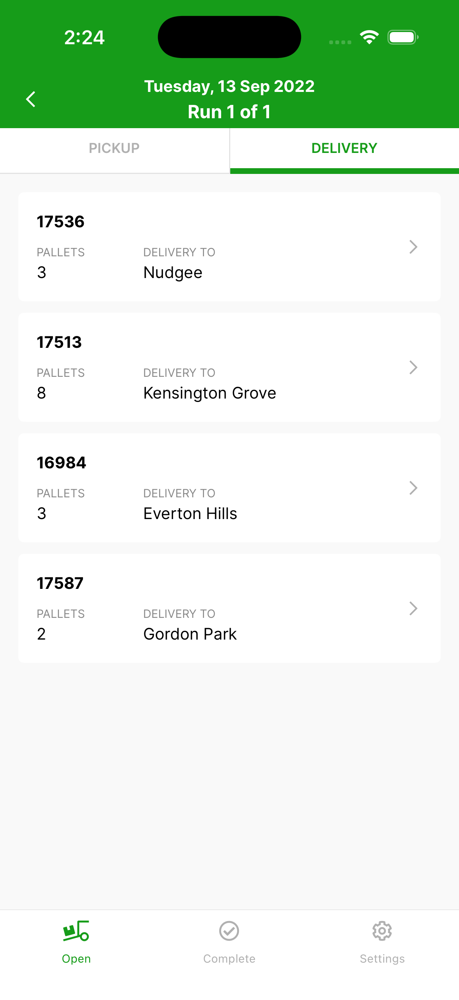
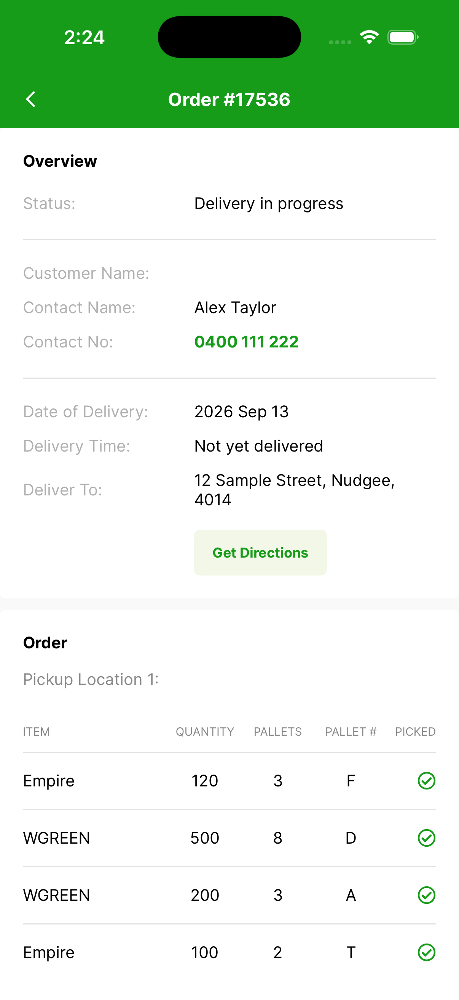
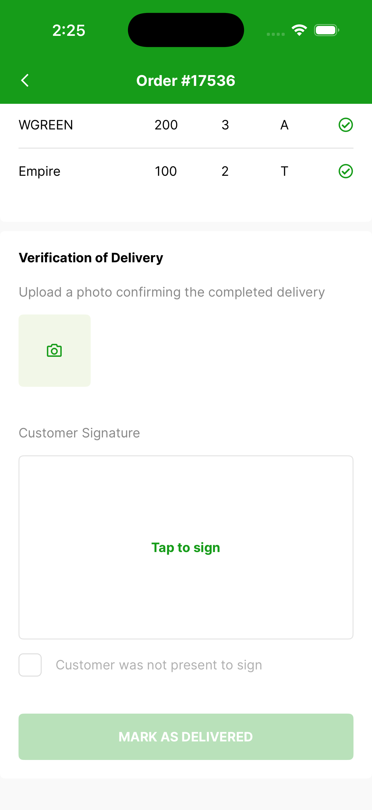
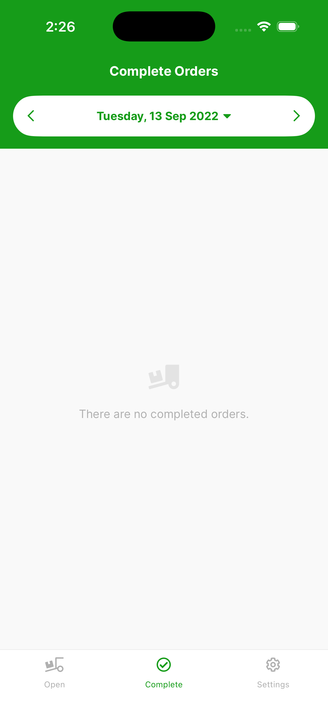
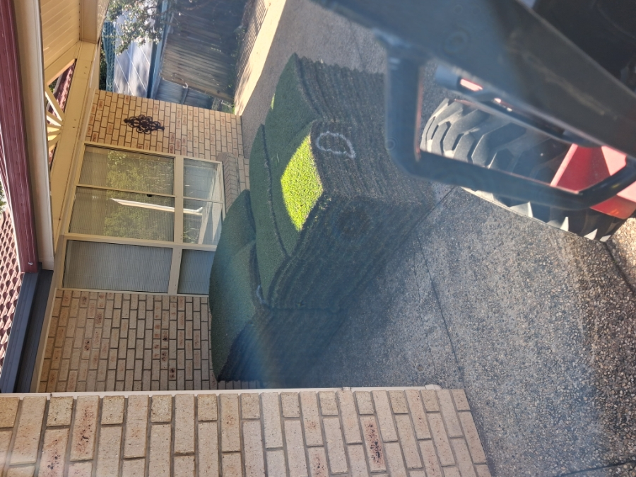

# Delivering an order

## Opening an order

Once a run is open, the **Delivery** tab lists every drop — the order number, the number of pallets, and the delivery suburb.

{ width="300" }

Tap any order to view its full details:

{ width="300" }

- **Status** — where the order is up to (for example, *Delivery in progress*).
- **Contact Name / Contact No** — the on-site contact. The number is tap-to-dial, so you can call the site with one touch.
- **Date of Delivery**, **Delivery Time**, and the **Deliver To** address.
- The **Order** section lists each item — turf variety, quantity, pallets, pallet code, and whether it has been picked up.

## Getting directions

Tap **Get Directions** in the order details to open the Maps app with a route to the delivery address.

## Completing the delivery

At the bottom of an order, the **Verification of Delivery** section is where the driver confirms the drop.

{ width="300" }

- Take or upload a photo as verification of delivery.
- Ask the customer to sign by tapping the **Tap to sign** box under **Customer Signature**.
- If the customer was not present, tick **Customer was not present to sign**.
- Then tap **Mark as Delivered**. The delivery time is logged automatically.

The completed order moves to the completed orders section. To see it, tap **Complete** in the bottom navigation bar. To carry on, return to the **Delivery** tab and open the next order.

{ width="300" }

## What happens when you mark it delivered

Tapping **Mark as Delivered** does three things at once — the driver doesn't have to do anything else.

**The proof is attached to the order.** The photo and the customer's signature are saved against the order the moment the driver taps the button, before the truck has left the site. In the web app, open the order and go to its **Documents** tab: the proof-of-delivery photo is listed under the category *delivery_verification* and the signature under *delivery_signature*, each with the time it was captured, and **View** opens it. They sit alongside any other documents on the order and can be re-sent to a customer at any time.

{ width="320" }

**The order is marked delivered.** Each item on the order is stamped with its delivery time. Once every item is delivered the order's status changes to **Delivered**, and it appears that way on the web app's order lists and reports.

**The customer is told.** Turfware sends the customer the *Order Delivered Email – request feedback* notification: a confirmation of what was delivered, with the delivery photo and signature embedded in the email, and a button inviting them to leave a review. It can go by SMS as well as email, and each send is recorded on the order's Timeline. See [Notifications](../web-app/notifications/index.md) to edit the wording or switch it off.

!!! note "When the customer wasn't there to sign"
    Ticking **Customer was not present to sign** lets the driver complete the delivery without a signature. The photo is still captured and attached, the order still moves to Delivered, and the customer still receives the delivery email — it just carries the photo without a signature.
