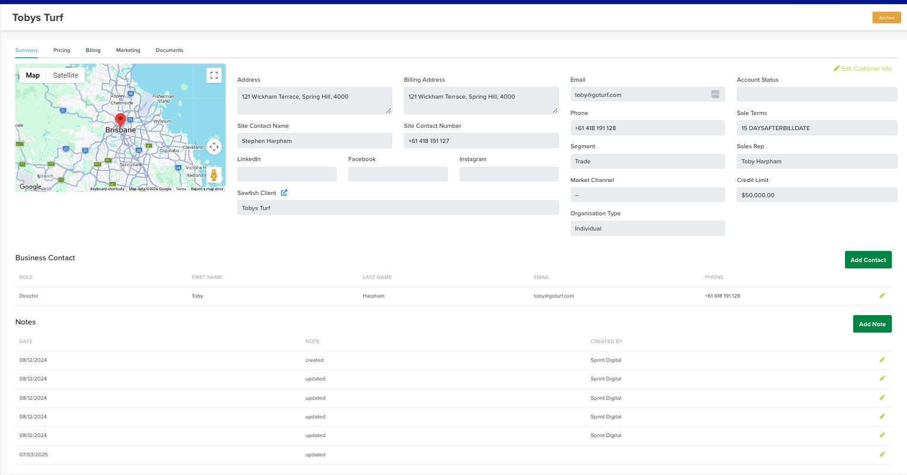
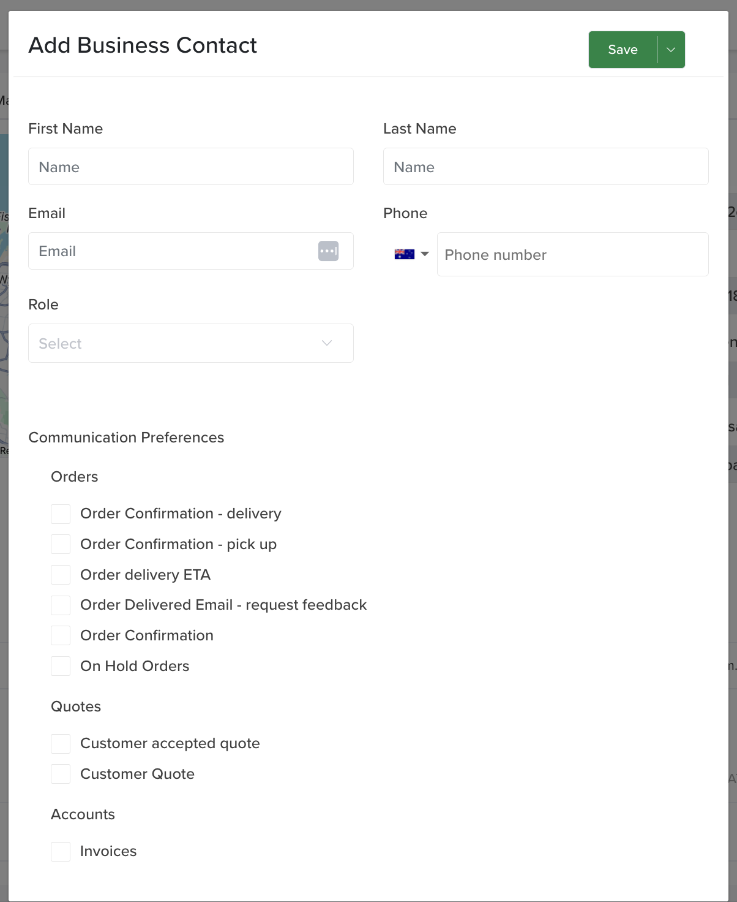
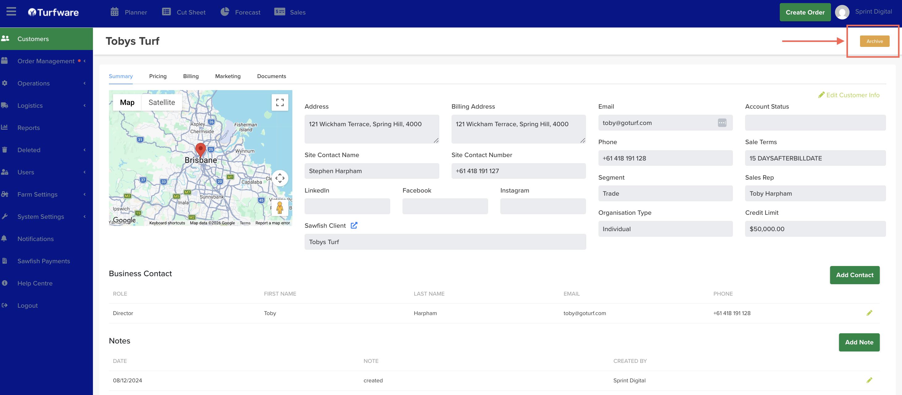

# Customer summary

Open a customer by clicking their row on the Customers page. The Summary tab is the customer's home — their details, contacts and notes in one place. Across the top are five tabs: Summary, Pricing, Billing, Marketing, Documents.

## Customer details

The summary shows the customer's address (mapped), billing address, site contact, email, phone, Segment, Organisation Type, Account Status, Sale Terms, Sales Rep and Credit Limit.

To change any of them, click ✏ Edit Customer Info (top right), update the fields, and save.

## Business contacts — who at the customer gets what

A customer record has one **primary contact** — the person on the customer's details, who receives every notification Turfware sends. Most businesses have more people than that: an accounts person who should get the invoices but not the delivery ETAs, a site foreman who needs the ETA and nothing else, an operations desk that wants order confirmations. **Business contacts** let you add each of them and choose exactly which messages they receive.

### Add a contact

Under **Business Contact**, click **Add Contact**. Enter their First and Last name, Email, Phone and Role (Director, Sales or Administration), then tick their **Communication Preferences** — the notifications this person receives:

- **Orders** — Order Confirmation (delivery), Order Confirmation (pick up), Order delivery ETA, Order Delivered Email (request feedback), Delivery Confirmation, On Hold Orders.
- **Quotes** — Customer accepted quote, Customer Quote.
- **Accounts** — Invoices.

Tick only what that person should get, and click **Save**. To change a contact's preferences later, click the pencil on their row.

### How a contact receives a message

- **Email** — when Turfware sends one of the ticked notifications to the customer, the contact is **copied in (CC)** on the same email. The primary contact still receives it, and the CC line shows who else did.
- **SMS** — where a notification goes by SMS as well (Order delivery ETA, for example), the contact gets their own text, provided they have a phone number.
- **Invoices** — ticking Invoices does more than copy an email: the contact is sent to **Sawfish as an invoice recipient** on the customer's client record, so Sawfish's invoice emails and payment reminders go to them as well as to the primary contact. This needs a first name, last name and email on the contact.

Whether a notification goes by email, SMS or both is set per template under [Notifications](../notifications/index.md); a contact's ticks decide *who* is included, not *how* it's sent.

### Typical setups

| Who at the customer | Tick |
|---|---|
| Accounts / bookkeeper | Invoices |
| Site foreman or installer | Order delivery ETA, Delivery Confirmation |
| Operations or scheduling desk | Order Confirmation (delivery / pick up), On Hold Orders, Order delivery ETA |
| Purchasing or the person who approves quotes | Customer Quote, Customer accepted quote |

A small landscaping customer often needs none of this — the primary contact gets everything. The value is with trade and commercial customers where the person placing the order, the person on site and the person paying are three different people.

## Add a note

Under Notes, click the green Add Note button. Notes are for customer call notes and important customer information you want on record — each note stores the date and who created it.

## Open the customer in Sawfish

An ⓘ next to the Sawfish Client link shows the customer's sync state: hover it to see when the details last synced with Sawfish, and any **sync error** or **sync conflict** with the time it happened — for example an email that Sawfish sent but which was already in use by another Turfware customer. Customer details flow Turfware → Sawfish → your accounting system; see [How the sync works](../../payments-accounting/how-the-sync-works.md#customer-details-sawfish-is-the-hub).

The Sawfish Client field links straight through (the ↗ icon) to the customer in the Sawfish payments system, where you'll find deeper payment and account information.

## Archiving a customer

Administrators can Archive a customer you no longer deal with — the Archive button, top right of the record. It's hidden from the Customers list but kept, not deleted.

Archived customers drop off the Customers list — flip Show Archived there to see them (their Status shows Archived) and Unarchive to restore one. See [Active and archived customers](index.md#active-and-archived-customers).
