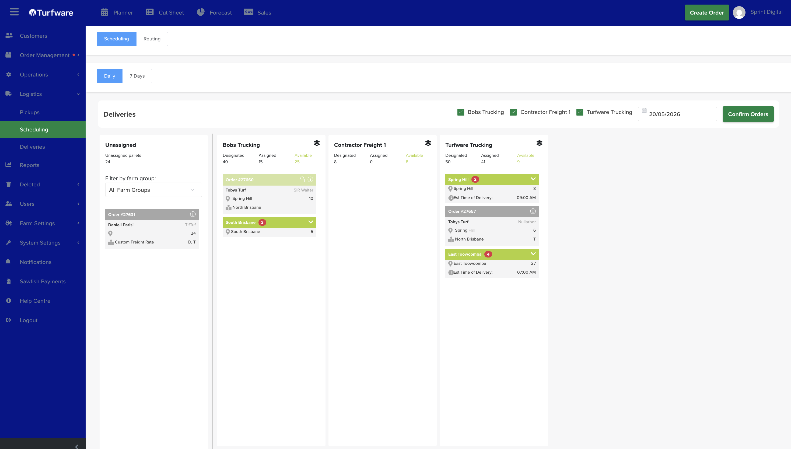

# How to use the scheduler

The Scheduling board is where the day's confirmed deliveries are assigned to carriers. Switch between **Daily** and **7 Days** at the top.

## Daily

Pick the delivery date. Tick a carrier at the top to show it as a column; the **Unassigned** column lists every order for that date not yet given to a carrier. Drag an order from Unassigned into a carrier's column to assign it, and click **Confirm Orders** to confirm that carrier's run and email them.

## 7 Days

A week at a glance — scheduled items grouped by carrier and date.

## Legs on the board

An order booked as [multi-leg freight](../../order-management/creating-and-managing-an-order.md#multi-leg-freight) puts one tile on the board **per leg**, each already in its carrier's column on its own date: *Leg 1 → Northgate Depot* on the collecting carrier for the leg date, and *Final → 12 Sample Street* on the delivering carrier for the delivery date. Each shows the order number, turf, m² and pallets.

Leg tiles carry a lock and the line *Set on order #27728 — change it there*: they can't be dragged, never sit in Unassigned, and are moved by editing the leg on the order. Confirm them with **Confirm Orders** like any other tile. The Planner's pallet totals count the order once, not once per leg.

## Transport report

**Transport report** (next to Add Truck) produces the day's run sheet for the chosen carrier and date as **CSV**, **Excel** or **PDF**. One row per turf line per leg: Order no., Delivery date, Pickup from, Customer, Address, Suburb, State, Post code, Site contact, Site phone, Customer email, Delivery instructions, Turf, Qty m², Pallets, Pallet type, Pallet code, Est. kg, Via depot and Depot address.

- Only **confirmed** runs are reported, as before.
- For a multi-leg order, the linehaul carrier's report for the leg date shows the depot as the destination; the delivering carrier's report for the delivery date shows the depot as the pickup. *Via depot* and *Depot address* are blank on a single-leg order.
- *Pickup from* is the farm's address on the CSV and Excel, and the farm's name on the PDF. The CSV keeps its existing columns in the same order, so it still imports into carrier systems.
