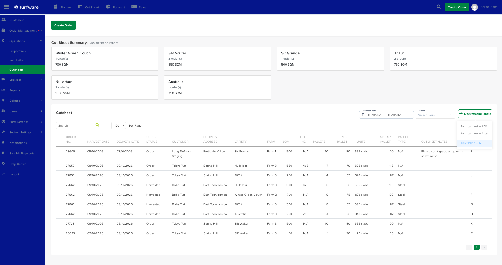
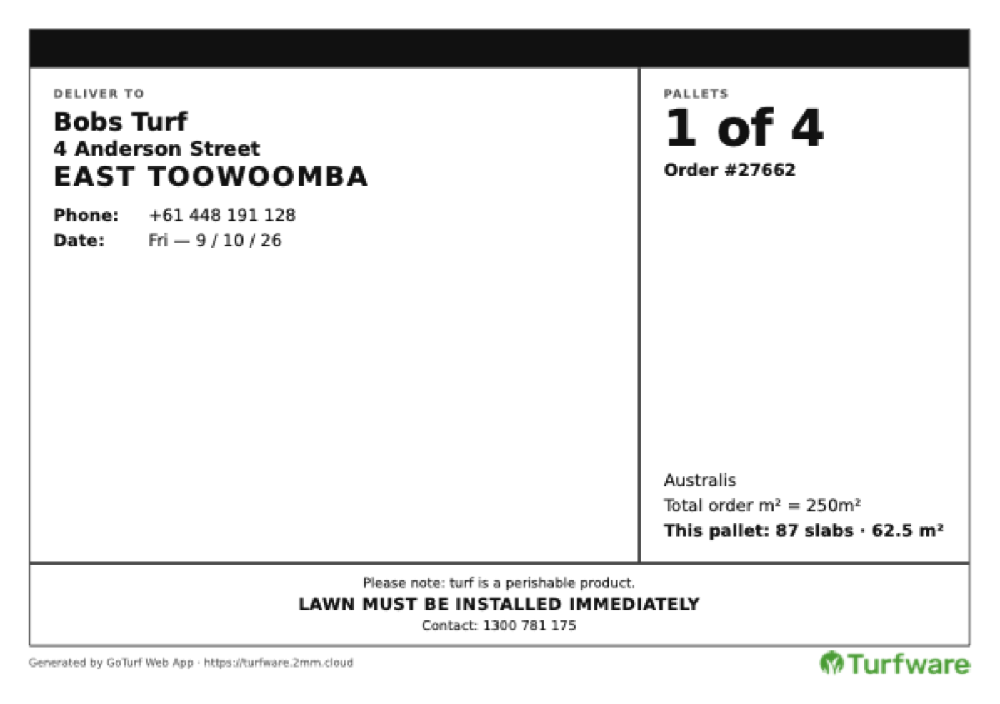

# Cutsheets

The Cutsheet report is a printable list of what the harvest team needs to cut.

!!! note "Not the same as the Dashboard Cut Sheet"
    This is the Operations **report**. The Dashboard [Cut Sheet](../dashboard/cut-sheet.md) is the live, on-screen view of harvest progress. Same source, different job.

## Where to find it

Left-hand navigation → Operations → Cutsheet.

## Cut Sheet Summary

Across the top, a card for each turf variety in the range shows its order count and total SQM. Click a variety card to filter the list below to just that variety.

## Filters

- **Harvest date** — the date (or range) to report on.
- **Farm** — optionally narrow to a single farm.
- **Search** — find a row by order number, customer, and so on.

## The list

Each row is one turf line on one order. Columns: Order no., Harvest Date, Delivery Date, Order Status, Customer, Delivery Address, Variety, Farm, SQM, **Est. kg**, Pallets, **m² / pallet**, **Units** (for example *179 rolls*), **Units / pallet**, Pallet Type, Cutsheet notes and Pallet Code.

The four new columns come from the turf item's [Cutting settings](../turfware-setup/farm-settings/turf-varieties.md#4-cutting): the unit count is m² × units per m², the estimated weight is m² × weight per m², and the per-pallet figures divide those by the number of pallets. The table scrolls sideways inside its own frame on a narrow screen.

## Dockets and labels

The **Dockets and labels** button (top right, same date and farm filter as the list) opens three choices:

- **Farm cutsheet — PDF** — the printable cut sheet. One page per farm per harvest date, with your business name at the top, a totals line (m², pallets, Est. kg) and the Turfware footer. Columns match the list: Order no., Turf, Qty (m²), m² / pallet, Qty (rolls/slabs), Per pallet, Pallets, Pallet type, Est. kg, Notes.
- **Farm cutsheet — Excel** — the same rows as a workbook, one sheet per farm, with Customer, Delivery date and Pallet code added at the end. The file is named for the farm and date, for example `Farm_cutsheet_HomeFarmMiddle_16-10-2026.xlsx`.
- **Pallet labels — A5** — one A5 landscape label per pallet for every order in the list, in the same order as the cut sheet. A preview opens first; click **Download** to get the PDF (`Pallet_labels_<date>.pdf`). Nothing is saved on the order.

!!! note "Screen and paperwork agree"
    All three use the **harvest date** you've filtered on — the same as the list — so what you see on screen is what prints. An order with no harvest date doesn't appear on any of them.

## What's on a pallet label

Each label is for one pallet and is meant to be read by whoever is loading or receiving it. Here's one as it prints:

Reading it:

- Who it's for: customer name, delivery address, site phone, and the order number.
- When and how: delivery date, the delivering carrier, and any delivery notes under **Comments**.
- What's on it: the turf variety, the units on this pallet (for example *179 rolls*), the m² on this pallet, and **Pallet 3 of 8** so a partial drop is obvious.
- For a multi-leg delivery, a strip showing the hand-over: the depot it goes via, the carrier for that leg and the leg date — see [Multi-leg freight](../order-management/creating-and-managing-an-order.md#multi-leg-freight).
- A reminder that turf is perishable and must be laid immediately, and your contact number.

### Changing what's printed on the label

Three things on the label come from your settings, under System Settings → [Company Information](../turfware-setup/farm-setup/company-information.md):

- **Your logo** — the **PDF Logo** under *Logo & Theme*, printed in the bottom corner. This is the same logo used on invoices and dockets.
- **Your name and number** — the **Display Name** and **Office / Main Phone Number** from *Company Details*, printed beside the logo as *Name · Phone*.
- **The Contact line** — the same **Office / Main Phone Number**, printed under the perishable notice as *Contact: …*, so whoever is handling the pallet knows who to ring.

Everything else on the label comes from the order — the customer, address, date, carrier, pallet count, turf and quantities — and can't be edited on the label itself; change it on the order and regenerate. The perishable notice and the *Generated by www.turfware.com.au* line are fixed.
