# Creating & Managing an Order

The Order page is where an order is built, saved, moved through your workflow, and invoiced. It has four tabs — Order Summary, Timeline, Documents and Invoicing — and a Status control and ⋯ actions menu in the top right.

This guide follows the full flow: building the order on the Order Summary tab, saving it, moving it through the workflow, and the key actions.

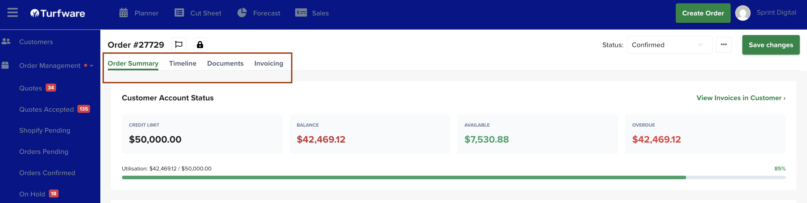

## The Order Summary tab

### Customer Account Status

Shows the customer's account position at a glance in four figures — Credit Limit, Balance (currently owing), Available (credit remaining) and Overdue — with a Utilisation bar showing how much of the credit limit is used, and a View Invoices in Customer link. It becomes active once a customer has been entered in Order Detail (below).

### Order Detail

- **Customer** — search across *all* customers in Turfware. The search returns the customer / business name and address, so you can tell two "John Smith"s apart. If the customer doesn’t exist yet, you can create a new Turfware customer directly from the order without leaving the page. And if they aren’t a Sawfish client yet, you can create/link that from here too, so their invoices sync to your accounts.

  Type a name that isn't already in Turfware and a Create new customer? option appears; click it to open the Create Customer form (email, name, segment, organisation type, contacts and billing/delivery addresses), then Save — the new customer is attached to the order.

  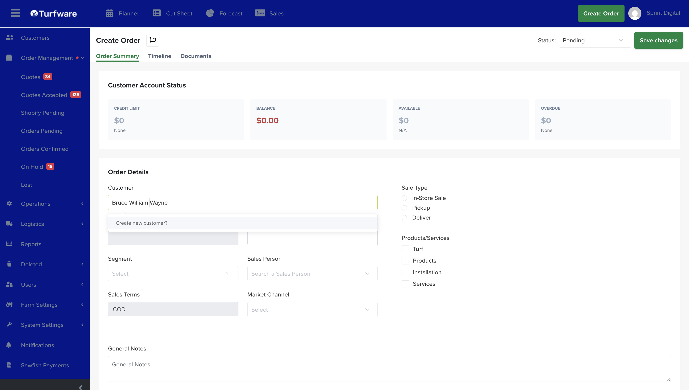

  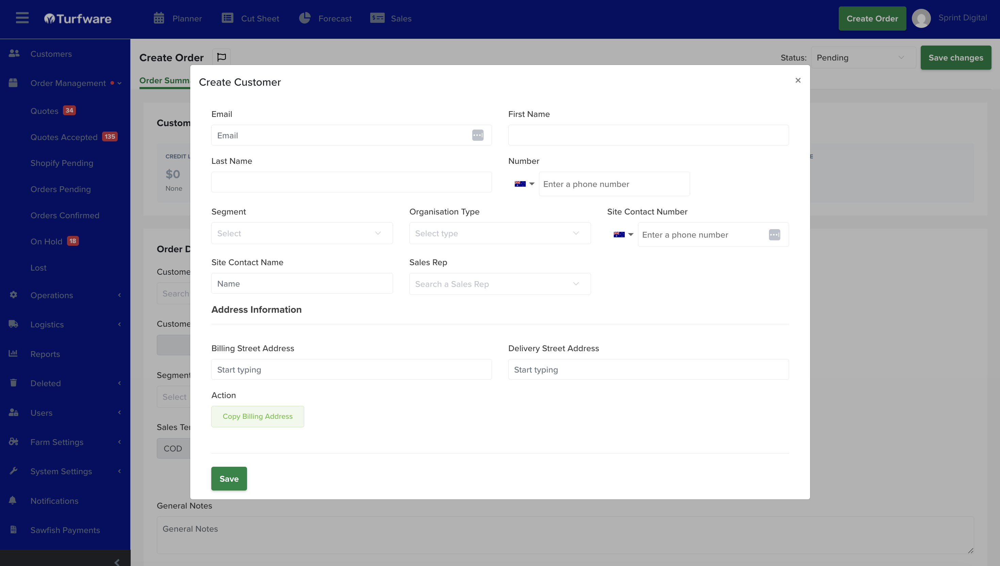
- **Segment & Sales Person** — if these are set on the customer's profile they're pre-filled; otherwise fill them in.
- **PO** — a free-text field. If you complete it, it becomes the reference field on the invoice, so the customer can match the invoice to their PO. If the customer supplied a PO document, attach it under the Documents tab for reference.
- **Market Channel** — set on the customer's record, not here (see [Adding a customer](../customers/adding-a-customer.md)). Existing orders keep the channel they had.

### Sales Type

How the order is fulfilled. Choosing a type reveals the matching section.

=== "In-store sale"
    A walk-in sale of stock on hand — e.g. fertiliser off the shelf, turf on display. This is a lite order: it does not enter the order workflow.

=== "Pickup"
    The order is collected at a location (set up in Farm Settings → Pickup Locations). Depending on how that location is configured, the order may or may not enter your logistics flow.

    Selecting Pickup reveals the Pickup section — complete Contact Name, Contact Number, Pick Up Location, Pickup Time and Pickup Date. This generates the pickup on the Pickup list (Logistics → Pickup).

    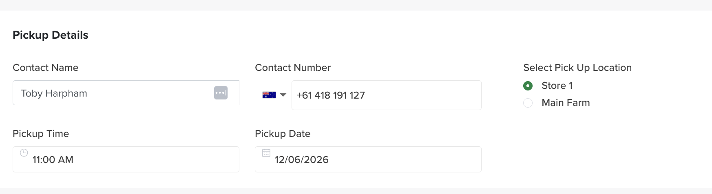

=== "Delivery"
    A Delivery date is required — the date the order is to be delivered. The Delivery section appears:

    - **Site Contact Name & Number** — important: the site contact receives an SMS with the delivery time once runs are locked in, and appears on the driver app for drivers to call if needed.
    - **Delivery Address** — copy it from the contact card or enter it manually. It's linked to Google Maps — drag the pin to set the exact delivery location.
    - **Delivery Rates** — auto-filled from your Freight Rate settings (Farm Settings → Freight Rates), by postcode. Switch to a custom rate to adjust or override. Use the Freight price toggle to show freight on the invoice as a flat rate or a $/m² rate.
    - **Delivery Notes** — a heads-up for the driver, e.g. *"Call Shawn on arrival, long driveway and he'll meet you out front."* Shows on the driver app.

    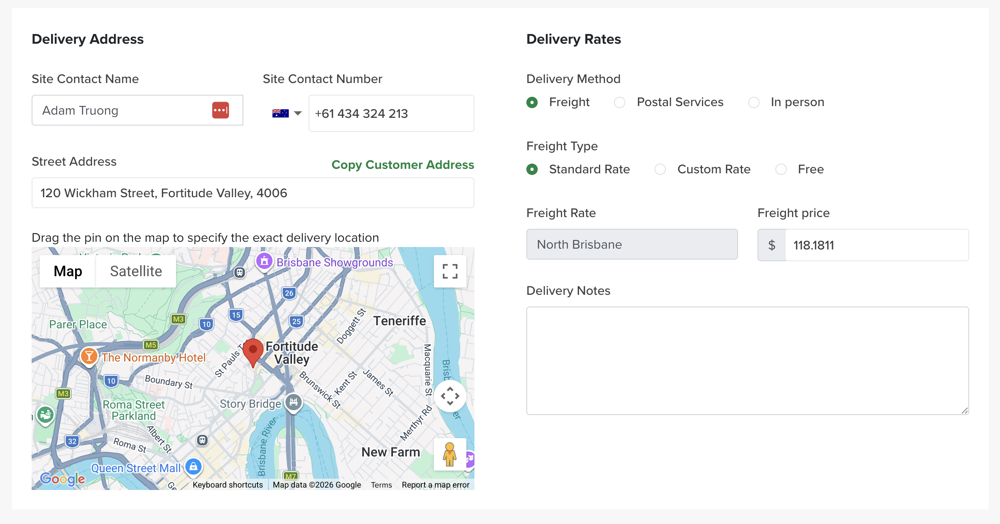

### Dates you can pick

- **Past dates are off.** In every date picker on the order — delivery, pickup, service (preparation) and harvest — days before today are greyed out and can't be chosen, and a note under the field says *Only an administrator can pick a date before [today]*. Administrators and super users (see [User Roles](../users/user-roles.md)) see the whole calendar and can back-date an order when they're fixing one. Turfware checks this on save too, so it holds even if the calendar is bypassed; existing orders with past dates still open and save.
- **The harvest date fills in for you.** When you set or change the delivery date, the harvest date pre-fills to match the rule in [Company Information](../turfware-setup/farm-setup/company-information.md#order-workflow) — *Same as delivery date* or *Day prior to delivery date* — with a small note saying which. It's an ordinary field: change it if the cut is on another day, and a date you've typed by hand is never overwritten when the delivery date moves. The pre-fill won't land on a past day.

### Full delivery days

How full a day can get is set by **Blocking orders: what counts against capacity** in [Company Information](../turfware-setup/farm-setup/company-information.md#order-workflow); pallet spaces per day come from your carriers and trucks.

- **Pending and confirmed orders** (the usual setting): a day that can't fit this order's pallets is **struck through** in the Delivery Date calendar and can't be picked. The legend under the field reads *Struck-through days are full for this order's 8 pallets and cannot be picked. A manager can still book them.* Because the strike-through is for *this* order, a day with 3 spaces left is open to a 2-pallet order and struck for an 8-pallet one. If the order grows after the date was chosen, a red panel appears — *12/10/2026 is full: 55 of 50 pallet spaces. Confirmed 38 + Pending 9 + this order 8* — with the next day that has room. Pick another date.
- **Confirmed orders only**: full days stay selectable and the order saves as Pending. The block lands when the order is **confirmed**: *Manager permission required*, exactly like the farm cut-off.
- **Managers.** Administrators and super users can book a full day in either mode, but never silently: a **Manager permission required** popup shows the numbers and offers *Book it anyway* or *Pick another date*. Booking it anyway is logged on the order's Timeline as an admin override with your name.

### Multi-leg freight

A delivery can be booked as more than one leg — a farm truck to a transport company's depot, and that carrier to the customer — so each carrier sees only its own leg on the Scheduling board and the transport report. Switch on **Multi-leg freight** under Delivery Rates and the **Freight legs** panel appears.

- **Leg 1** — the collecting carrier. *From* is read-only: the farm (or farms) on the order's turf lines. *To* is the hand-over depot — the list offers each carrier that has a [depot](../turfware-setup/farm-settings/carrier-settings.md#depot) set up. Pick the leg's date and add notes for that leg.
- **Final** — the delivering carrier. *From* is the previous depot and *To* is the delivery address, both locked. Its date is **the order's delivery date** (marked *= order delivery date*) — change the delivery date and the final leg moves with it.
- **+ Add leg** inserts another hand-over before the final leg. Leg dates must run in order and can't be later than the delivery date.

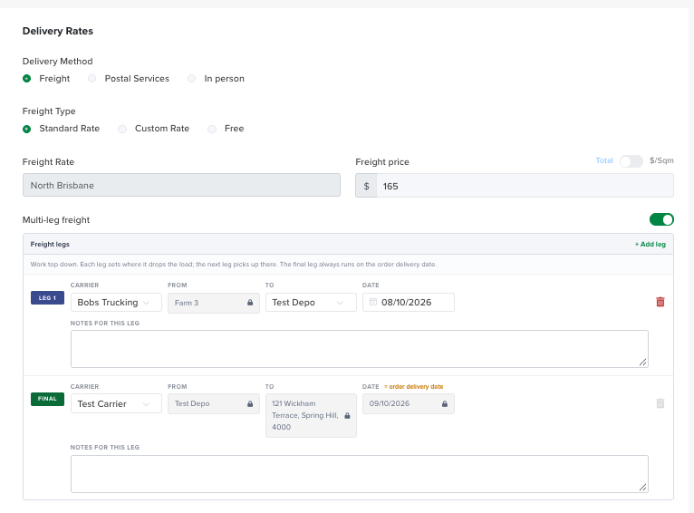

Freight pricing is unchanged — the Delivery Rates and freight price still price the delivery to the customer; legs are about routing. Switching **Multi-leg freight** off removes the legs and brings back the single Delivery Notes box. Pickup and in-store orders never show the panel.

Once legs are saved, the Order Summary's freight line reads *Freight · 2 legs*, every leg change is written to the Timeline (*Leg 1 changed: carrier X to Y; date 11/10 to 12/10*), and editing legs on a confirmed order asks you to confirm first. Each leg becomes its own locked tile on the [Scheduling board](../logistics/scheduling/how-to-use-the-scheduler.md#legs-on-the-board) and appears on that carrier's [transport report](../logistics/scheduling/how-to-use-the-scheduler.md#transport-report).

### Products & Services

What's available here is set by Company Settings → Order Settings — only the products and services you've enabled appear.

=== "Turf"
    A Harvest date is required — the date the turf appears in the Harvesting App to be cut for this order. **You usually won't need to type it**: when you set the delivery date, the harvest date fills in automatically — either the same day or the day before, whichever your business has chosen under System Settings → [Company Information → Order Workflow](../turfware-setup/farm-setup/company-information.md#order-workflow) (*Pre-fill harvest date*). A small note under the field shows which rule applied.

    It doesn't have to stay that way: change it if the cut is on another day (a Friday cut for a Monday delivery, say). A harvest date you've set by hand is kept even if the delivery date later moves, and the pre-fill never lands on a past day.

    Opens the Turf section, where you select the turf varieties for the order. Turfware handles multiple varieties per order — the workflow splits for the harvesters but the order always keeps one unique order number. For each variety, select the farm it's harvested from and the SQM; the rest pre-fills from your Turf settings and the customer's segment. Select the harvesting pallet type.

    Cut sheet notes — notes for the harvest team, e.g. *"display home order."*

    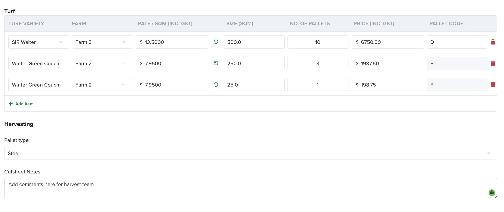

=== "Product"
    Select the product, the stock location (if the product is linked to Shopify for inventory management) and the units. The rest pre-fills from the product's setup.

    Products and services sold by measure now accept **decimal units — up to two places** (e.g. 2.5), so you can order part-loads or fractional quantities; whole-unit items stay whole numbers, and every total recalculates to the cent.

    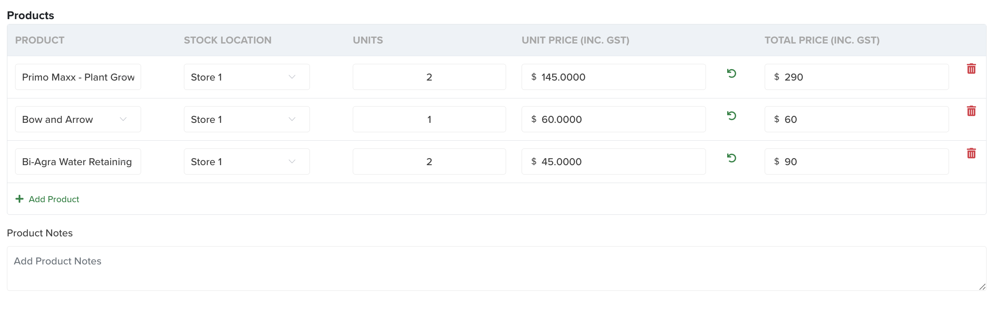

=== "Installation"
    Pre-calculates from the laying rates on the customer's segment. You can also set a custom installation price. As with freight, choose how it appears on the invoice — flat rate or $/m².

    The key difference from other services: you select the installation supplier (set up in Farm Settings → Suppliers).

    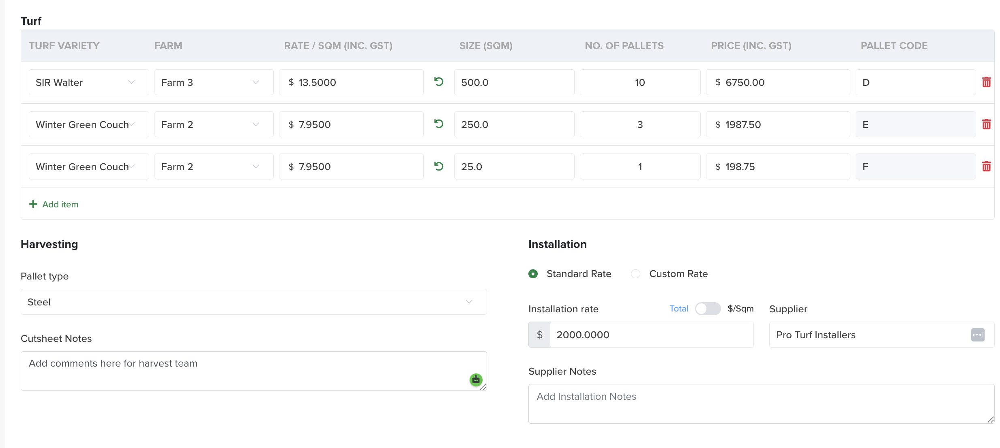

=== "Services"
    Services you provide that may happen on a different date to the turf or product delivery — e.g. preparation or maintenance. Because of that, a service has its own date, which triggers its own workflow: setting a service date populates it on Operations → Preparations. Otherwise it works like a product, pulling from Farm Settings → Services.

### Order Summary

The order value, calculated line by line, replicating the invoice values. Apply a discount as a field on any line item — the same way Xero, MYOB and Shopify do it (e.g. 25% off a product). The discount shows on the invoice, so the customer can see it applied.

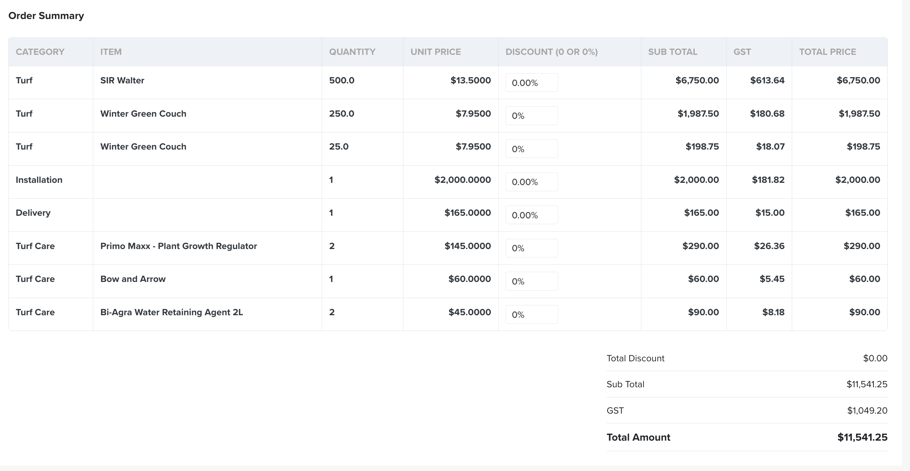

## Saving the order

!!! warning "An order must be saved to be captured"
    Click Save changes. On save, the order defaults to Pending. Pending orders don't appear in any workflow (harvest, delivery) yet.

## Moving the order through the workflow

To move an order into the workflow, change the order Status in the top-right of the order (Pending → Confirmed). Depending on your admin settings, there may be a blocker.

!!! note "Require Payment Before Confirmation"
    Set under System Settings → Company Information → [Order Workflow](../turfware-setup/farm-setup/company-information.md#require-payment-before-confirmation). It's off until an administrator switches it on. When enabled, it's a hard-stop preventing Pending → Confirmed unless payment criteria are met — protecting you from harvesting turf for orders that won't be paid.

    An order may be confirmed when any of these is true:

    - the order is marked Paid, or
    - a payment has been recorded via Receive Payment (Manual), or
    - the customer has active Account Terms *and* the order is within their credit limit (total outstanding invoices &lt; credit limit).

    Administrator override — only an Administrator can force-confirm an unpaid order. This triggers an *"Order Not Paid"* confirmation popup, and the override is recorded in the order Timeline.

!!! tip "Recording a payment"
    Any user or super-user can record a payment on an order at any time via the Received Payment button (under *Payment Status*) — there's no cut-off-time restriction, so you don't need manager permission. Enter the payment method, date, reference and any notes. Recording a payment can move the order to Confirmed, and it's how you log payments taken outside Sawfish — e.g. cash or bank transfer.

## Order actions (the ⋯ menu)

The key actions live in the ⋯ menu in the top-right of the order.

### Send confirmation

Sends an email confirmation of the order to the customer. We recommend sending it — it provides a validation of the order confirmation. It uses the *Order Confirmation – delivery* or *Order Confirmation – pick up* template, which you can customise under [Notifications](../notifications/index.md#orders). A popup appears, pre-filled with that order's information; add email addresses and adjust the wording to suit. Once sent, the menu item reads **Resend Confirmation** and the send is written to the Timeline.

!!! note "Two different confirmations"
    Customers can get two confirmations, and neither goes automatically — someone sends each one.

    - **Order confirmation** (this one) — confirms the order itself: what's coming and the date. Sent from the order's ⋯ menu.
    - **Delivery confirmation** — tells the customer their delivery window once the order is on a truck. Sent per truck from [Routing](../logistics/scheduling/how-to-use-the-routing-feature.md#tell-customers-their-delivery-window), so every customer on that run gets theirs at once.

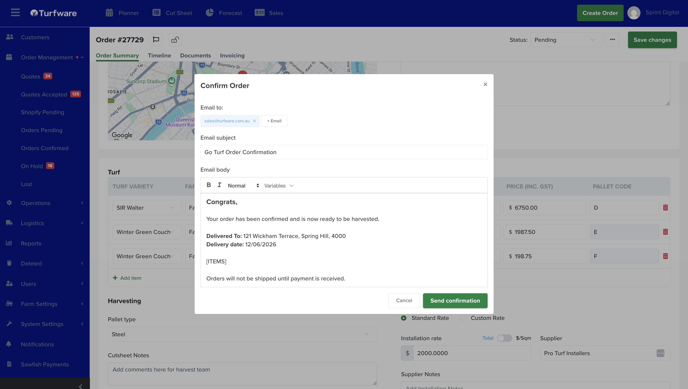

### Put on hold

Takes the order out of the workflow, saves all its information, and stores it on its own list (Orders → On Hold) to come back to. Typically used for rain delays, site delays, etc. — the order may even be paid, but is on hold operationally. When it's ready, move it back: by default it returns to Orders Pending so you can update the harvest and delivery dates.

While an order is on hold, an On Hold badge shows on the order (next to the lock icon), so its status is clear at a glance.

### Mark as lost

If an order isn't going ahead, move it to Lost — it's closed and archived but kept for reporting and marketing. See [Lost](lost.md).

### Generate invoice

Generate and send the customer's invoice. There are three decisions:

1. **Invoice date** — defaults to today's date; adjust if required.
2. **Due date** — auto-populates from the customer's payment terms. No terms → due date = invoice date; 14-day terms → due date = invoice date + 14. You can also set it manually.
3. **Generation option** — Draft, Approve Only, or Approve & Send (matching Sawfish). Only Approve & Send emails the invoice to the customer now. Draft and Approve Only generate the invoice without sending — send it later from the Invoicing tab, where you can also view and print it.

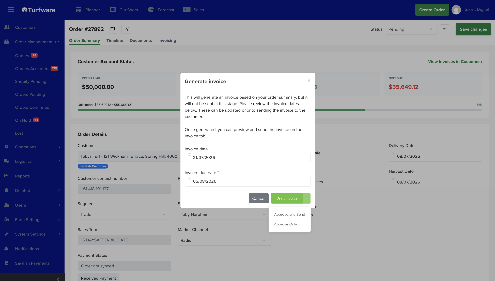

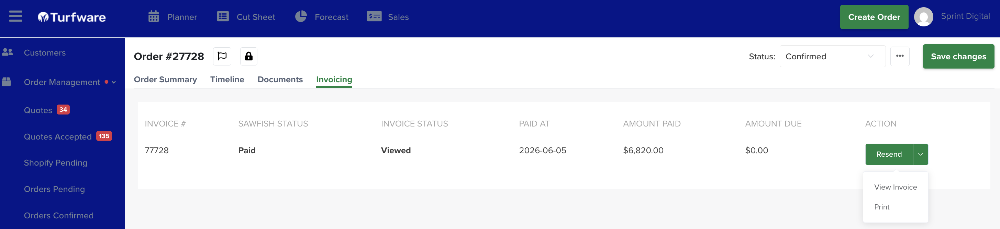

!!! tip "Where invoices live"
    Every invoice for an order is listed on its Invoicing tab — showing invoice number, Sawfish status, invoice status, amount paid and amount due — with Approve and Send / Approve Only / View / Print actions.

A **Template** picker on the Generate Invoice dialog lets you choose which Sawfish invoice template the invoice uses (default: *Organisation default template*). It lists your Sawfish templates grouped by layout — Detailed, Simple or Consolidated — and the same choice is offered when you [send a quote](quotes.md#send-a-quote), so the quote the customer saw and the invoice they receive match. Then choose **Draft Invoice**, **Approve Only** or **Approve and Send**.

**Link an existing Sawfish invoice.** If an invoice for this order was raised directly in Sawfish — a deposit or completion invoice done by hand — the order shows *No Invoice Created*. Click **Link Sawfish Invoice** and search by invoice number, reference or client name to attach it. Turfware keeps a nightly snapshot of Sawfish invoices that aren't linked to any order, so the one you want is there to pick. Once linked it behaves like an invoice Turfware generated: it's on the customer's Billing tab and in their balance.

## Flag or lock an order

Two controls sit beside the order number at the top of the order:

- **Flag** — click the flag icon to flag the order for attention (for example, something needs checking before it proceeds).
- **Lock** — the lock icon freezes the order so key details can't be changed by accident. While an order is locked, these fields are disabled: customer, segment, sales person, services, pallet type, purchase order, market channel, delivery location, freight price, deliveries and installation (layer / laying). Click it again to unlock and edit.

!!! tip "Looking for the proof of delivery?"
    Once a driver has marked the order delivered, the delivery photo and the customer's signature are on the **Documents** tab (listed as *delivery_verification* and *delivery_signature*), and the status at the top right reads **Delivered**. See [what happens when an order is marked delivered](../../delivery-app/delivering-an-order.md#what-happens-when-you-mark-it-delivered).

## The Timeline tab

The Timeline tracks every change to the order — what changed, who changed it, and when. Open it from the order's Timeline tab. Each entry shows:

- # (ID) — the change record's identifier.
- **Description** — a summary of the change (e.g. *"Order Status Updated"*).
- **Audited** — what changed, including the old and new values.
- **Causer** — the user who made the change, or System for an automated update.
- **Created At** — when it happened.

Administrator overrides — like force-confirming an unpaid order — are recorded here too.

## The Documents tab

Store files against the order — purchase orders, site plans, anything relevant. Open the Documents tab, click Upload (top right), choose the document type and file, and upload. All the order's documents are listed on this tab.

This is also where the **proof of delivery** lands. When the driver marks the order delivered in the [Delivery App](../../delivery-app/delivering-an-order.md#what-happens-when-you-mark-it-delivered), the delivery photo and the customer's signature are attached here automatically — listed as *delivery_verification* and *delivery_signature* with the time they were captured. Click **View** to open either.

When you upload, you'll see an **Attached in Invoice** checkbox.

!!! tip "Send a document with the invoice"
    Tick **Attached in Invoice** and that file is sent to the customer together with their invoice — no need to email it separately. Ideal for site plans, compliance or warranty certificates, delivery dockets, or a signed copy of the quote. It's sent once, with the invoice; leave the box unticked to keep a file on the order for your own reference only.
