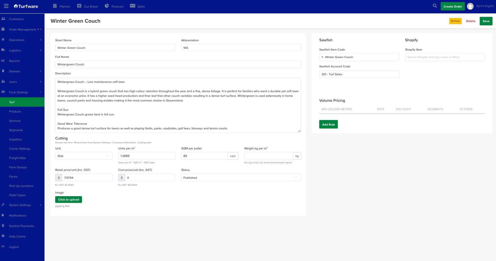
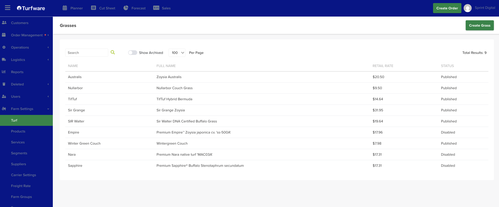

# Turf Varieties

A turf variety is a grass you sell. Each one holds its names, pricing, cutting and pallet figures, accounting links and volume pricing — so that once it's set up, it flows correctly through orders, cut sheets, delivery and invoicing.

## Where to set them up

Go to Farm Settings → Turf. Click Create Grass to add a new variety, or click any row to edit an existing one.

## 1. Naming

A variety has three names, each used in a different place — so it reads clearly for staff, for drivers, and for customers:

- **Short Name** — what staff see: order screens, quotes, the delivery docket and coversheet, the order PDF and the Harvesting App cut sheet. Keep it short (e.g. *Sir Walter*).
- **Abbreviation** — the shorthand on the web Cut Sheet dashboard, where space is tight.
- **Full Name** — what the customer sees: the invoice line, the order confirmation email and their order view (e.g. *Sir Walter DNA Certified Buffalo Grass*). If it's blank, the Short Name is used on the invoice instead.

For the full picture of which field lands where — on the invoice and everywhere else — see [What goes on the invoice](../../../payments-accounting/what-goes-on-the-invoice.md).

## 2. Description

Internal notes about the turf — characteristics, care, ideal use. For your team only; not shown to customers.

## 3. Price settings

- **Retail price/unit** — your full retail sell price per m². The baseline every other segment is discounted from. The label says whether you're entering it Inc. or Ex. GST (set under Company Information → Pricing Settings), and the other figure is shown underneath.
- **Cost price/unit** — what the turf costs you per m² (production cost, or wholesale purchase price if bought in). Used for margin reporting.
- **Image** — optionally upload a photo of the variety (jpg or png).

## 4. Cutting

How this variety is cut, and how a square-metre quantity turns into a count the yard can work with. These were company-wide settings until now; they're set per turf item so that *Sir Walter – Small Roll* and *Sir Walter – Slab* each count correctly.

- **Unit** — Roll or Slab. Shows on the [cut sheet and pallet labels](../../operations/cutsheets.md) and the customer's [invoice](../../../payments-accounting/what-goes-on-the-invoice.md) ("715 rolls").
- **Units per m²** — how many rolls or slabs make up one square metre (for example 1.43 for a small roll, 1.39 for a slab). Turfware multiplies the order's m² by this to get the unit count, and the helper text under the field shows the sum for a 500 m² order as you type — *slabs per m² · 500 m² = 695 slabs*.
- **SQM per Pallet** — how many square metres fit on a pallet. Drives the pallet count on every order.
- **Weight (kg) per SQM** — average weight of one square metre. Used for the estimated weight on cut sheets and the transport report, so trucks can be planned.

!!! note "Varieties set up before this release"
    Every existing variety was given a Unit and Units per m² from the old company-wide Cutting style setting, so nothing changes until you edit it. A variety with no Units per m² falls back to that company setting.

## 5. Status

- **Draft** — still being set up; does not appear on orders.
- **Published** — live and available to sell.
- **Disabled** — hidden from new orders but kept on record.
- **Delete** — removes the variety.

## 6. Sawfish settings (required for invoicing)

!!! warning "Required for invoicing"
    These fields link the variety to your accounting system. If they aren't completed, Turfware cannot generate an invoice for orders containing this turf, and nothing syncs to your accounts. Complete both before publishing.

- **Sawfish Item Code** — the item this variety maps to in your accounting system. Create the matching item there first, then select it here.
- **Sawfish Account Code** — the chart-of-accounts code revenue from this variety posts to.

Create the matching item and account in Sawfish first, then enter their codes here — Turfware syncs the invoice to Sawfish (see [Sawfish Configuration](../farm-setup/sawfish-configuration.md)).

## 7. Shopify

If you sell this variety online, link it in the Shopify panel on the right-hand side of the page (next to Sawfish): in the Shopify Item field, search for and select the matching item from your Shopify catalogue. Without the link, the online order can't be invoiced. See the Processing Shopify Orders guide for the full flow.

## 8. Volume pricing

Volume pricing lets you offer discounted rates by order size, per customer segment. Set the volume ranges (e.g. 0–100 m², 100–500 m², 500 m²+) and each segment's rate per range; Turfware automatically applies the right price on an order based on the quantity ordered.

## Save

Click Save. If the status is Published, the variety is immediately available on new orders, apps, cut sheets and invoicing.

## Archiving

Retire a turf variety you no longer use by Archiving it — it's hidden from the list and no longer available to select on new orders, but kept (not deleted). Flip Show Archived on the list to see archived records, and Unarchive to bring one back.

The Archive action and Show Archived toggle work the same across all these records — see [Archiving a customer](../../customers/customer-summary.md#archiving-a-customer) for a picture.
